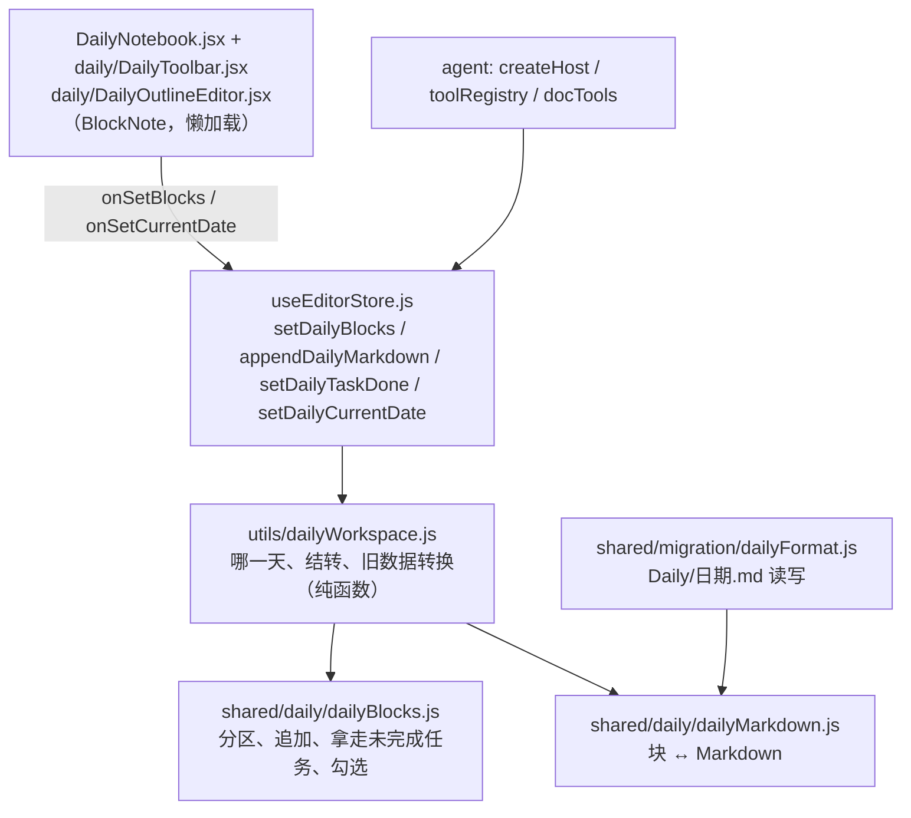

# 今日速记（幕布式大纲）改动规范

一天 = 一篇 BlockNote 文档（块数组）。默认三个顶层标题分区：`📝 今日任务` / `📅 事件` / `💡 笔记`。
**分区就是顶层标题**：标题之后、下一个标题之前的块都属于它；用户把内容缩进到标题下面（标题有 children）时按 children 算。

## 分层



数据形状：`{ currentDate, entries: { 'YYYY-MM-DD': { date, blocks } } }`。没有 todoPool（旧数据 normalize 时并进去）。
`shared/` 下的文件主进程（迁移）和 renderer 共用，**不能依赖 DOM / BlockNote**。

## 关键约定

1. **切日期 ≠ 结转**。手动翻日期只走 `setDailyCurrentDate`（改 currentDate）；只有切到真实今天（含「今天」按钮、凌晨跨天定时器）才跑 `carryOverIncompleteTasks`。
2. **结转**：所有 `< 今天` 的日子里**未勾选、非空**的 `checkListItem`（连同子级）拿走，追加到今天「今日任务」末尾；今天已有同名未完成任务的跳过（`dedupeTasks`），所以幂等。已勾选、笔记、事件原地不动。今天没内容时先套模板，空占位行会被替换。
3. **空就删**：`isDailyBlocksEmpty`（只剩标题和空行）的一天从 entries 删掉，不写文件；编辑器对没内容的日子显示模板但不落盘。
4. **编辑器是非受控的**：`DailyOutlineEditor` 挂载时取初值，按日期 `key` 重挂；改动防抖 400ms 往上抛（失焦、卸载时立即抛）。外部改动（AI 写入、结转、文件被改）= store 里的 blocks 不是自己上次抛出去的那份 → `replaceBlocks` 整篇替换；防抖未落时以用户输入为准。卸载前那次保存要落到**挂载时的日期**（dateRef），别用新日期的闭包。
5. **图片**：粘贴走 `useEditorImageUpload` 的 `insertImagesFromFiles`（占位 → 存进内容库 `assets/` → 回填 local-media://）；`blob:` 占位没回填前不保存（`hasPendingImagePlaceholders`）。Markdown 里写本地绝对路径（带空格用 `<...>`），读回再转 local-media://。
6. **日历打点**：工具栏日历用 antd Calendar 的 `cellRender` 给有记录的日子画小圆点，数据来自 `getDailyRecordedDates`（非空 entries）；圆点绝对定位在 `.ant-picker-cell-inner` 里，别撑高格子。
7. **粘贴文字会丢圆点**：粘网页内容 / 多行文字时 BlockNote 生成 `paragraph`，粘进空条目还会把整块换成段落。`DailyOutlineEditor` 的粘贴先记块类型（`collectBlockTypes`），粘完用 `getPastedParagraphFixes` 把「新变成段落」的块改回条目；块菜单「正文」只把圆点/待办/编号算激活，段落点「正文」能加回圆点（`utils/dailyBlockMenu.js`）。
8. **BlockNote schema**：`buildSchema` 默认会去掉 heading，速记必须显式传 `excludeDefaultBlocks`（现在只去掉 table/video/audio/file）。

## 文件格式（Daily/YYYY-MM-DD.md）

```markdown
---
date: 2026-10-09
---

## 📝 今日任务

- [ ] 一些需要 hotfix 的问题
- 剧情播放预研
  - 价值：整合配音、美术资源
  

<!-- md-render:data
{"version":2,"hash":"…","blocks":[…]}
-->
```

- 正文是给人和 AI 看的干净大纲；数据块存完整 block JSON（颜色、id）。**正文 hash 对得上才用 JSON，否则按正文重新解析**（外部在 Obsidian 里勾选、加行都能读进来）。
- 旧格式（`## 记录` + `[type:: task]` Dataview 字段）只读：`parseLegacyDailyItems` → `legacyItemsToBlocks`，分区标题 id 固定为 `<日期>-section-<key>`、条目沿用旧 id，迁移按 id 合并不会重复。
- `Todo.md` 只写「已并入」说明。加载后缓存里 Todo.md 记磁盘原样（`buildLoadedDailyCache`），下一次写回就把旧待办清掉，避免反复并入。
- 硬性要求：`parse(serialize(x))` 完全相等（`findDailyRoundTripMismatches`，迁移时不为空就不切换）。

## AI 工具（app 内和 MCP 共用，见 riskLevels.js）

| 工具 | 作用 |
|---|---|
| `read_daily` | 返回 `{ date, markdown, undoneTasks }` |
| `add_daily_entry` | `type` = task/event/note 选分区；`text` 可多行大纲，任务分区的普通行自动变成 `- [ ]` |
| `add_todo_entry` | 兼容旧名：加到今天的今日任务 |
| `complete_daily_task` | 按文字勾选（先全等，再包含）；没找到返回「勾选失败：…」 |

AI 面板「📌 记下来」（`createHost.pinInspiration`）也写速记：`core/agent/inspirationNote.js` 把灵感拼成「- 灵感 · 会话名」+ 缩进正文 + 来源，追加到当天「💡 笔记」。正文里的 `#` 标题要去掉，否则会被解析成新分区。

新增工具要同时改：`toolRegistry.js`（定义 + handler + label）、`createHost.js`、`shared/capabilities/riskLevels.js`、`shared/vaultAgentsMd.js`（给直接读文件的 agent 的映射表）、`server/mcp-bridge/README.md`。

## 笔记汇总（右侧面板，按周归档）

- `utils/dailyNotes.js`：`collectDailyNotes` 收集每天「💡 笔记」分区的**顶层**条目（`getSectionItems`），`groupNotesByWeek` 按周一开头分组，`filterNotes` 筛未整理 / 已整理。
- **已整理 = 行尾 `#已整理` 标签**（`dailyBlocks.js` 的 `setBlockOrganized`），不加字段、不改文件格式；标签必须独立成词（前面是空白或行首）。展示时用 `stripOrganizedTag` 去掉。
- 标记走 store `setDailyNoteOrganized(date, blockId, organized)` → `updateBlockById`；当天编辑器靠「storeBlocks 不是自己抛出的那份」整篇替换，不需要额外同步。
- 点笔记跳转：`DailyNotebook` 的编辑器 key 是 `日期:focusNonce`，每次跳转 +1 让它重挂，同一天里也能重新定位光标。
- 测试：`tests-unit/daily-notes.test.js`。

## 大纲页面 / 思维导图（和速记共用）

- 大纲页 = 普通 `.md` + frontmatter `layout: outline`（`shared/outline/outlineTree.js` 的 `isOutlinePage`）；属性面板「页面」可切换（`shared/properties.js` 的 `layout` 定义）。新建入口：侧边栏「新建大纲」→ `MarkdownEditor.handleAddOutline`（先 `handleAddFile` 再写 frontmatter）。
- 主编辑器里的状态在 `hooks/useOutlinePage.js`：视图按文件记、空文档首行变圆点、BlockNoteView 加 `outline-editor` 类复用速记的缩进样式。**切到导图时编辑器不卸载**，只用 `.editor-layout.is-mindmap` 藏起来。
- 速记切到导图时编辑器会卸载（卸载前自动 flush），导图读 store 里的块。
- 导图树：`blocksToMindTree(blocks, rootLabel)`——children 是子节点，标题按级别收下后面的平级块（速记分区就是平级的）；空行、分割线跳过。
- 导图组件 `components/outline/MindMapView.jsx`（只读，平移 / 缩放 / 折叠），连线全是 CSS 伪元素；点节点 → `focusOutlineBlock` 回大纲定位。父级用页面 id / 日期当 key 重挂。
- 测试：`tests-unit/outline-tree.test.js`。

## 验证

默认不主动跑测试；用户要求时跑 `pnpm test:unit`。重点用例：
1. 切到过去 / 未来 / 来回切 → entries 不变
2. 进入今天 → 昨天未勾任务连子级搬到今日任务；已勾选、笔记不动
3. 重复进入今天 → 不重复
4. 今天已有同名任务 → 不重复加，旧日子清掉
5. 今天没内容 → 套模板，任务替换空占位行
6. 编辑器写回只剩模板 → 那天被删掉
7. `add_daily_entry` 多行缩进 → 顶层变任务、子级保留；分区不存在则新建
8. 文件往返一致；外部勾选 / 加行能读回；旧格式能读成大纲且 id 保留
9. 旧条目 + 待办池 normalize → 大纲，待办并进今日任务
10. 粘贴截图 → 存进 assets/，Markdown 是本地绝对路径

测试：`tests-unit/dailyWorkspace-switch-date.test.js`、`daily-markdown.test.js`、`migration-daily-format.test.js`、`vault-file-sync.test.js`、`agent-create-host.test.js`。
`shared/daily` 的块能被真实 BlockNote 吃进去，可以在 vitest 里 `BlockNoteEditor.create({ schema, initialContent })` 验证。
